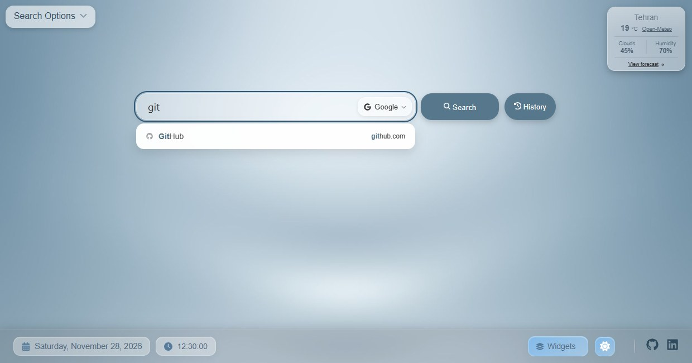
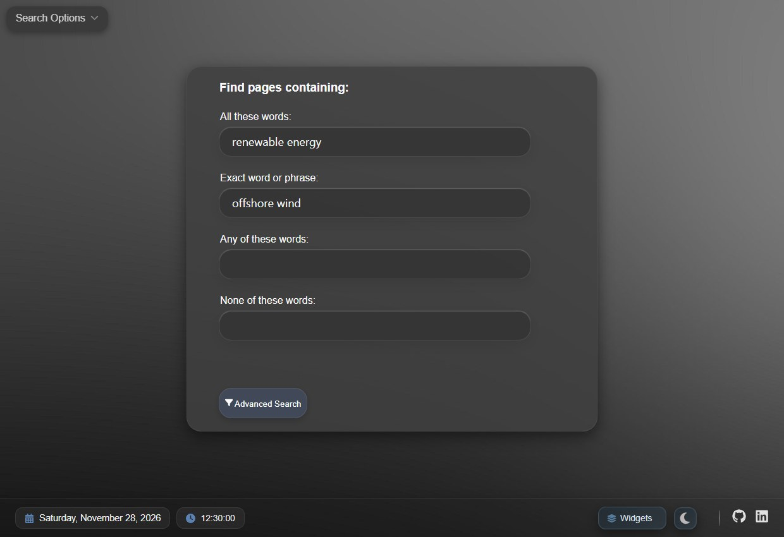
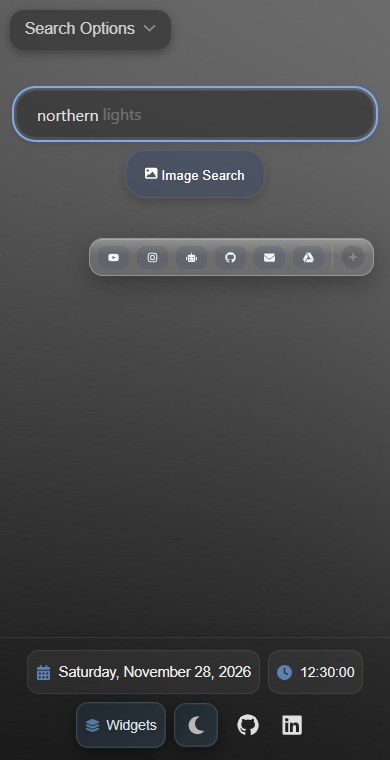

# 🔎 WebSearchApp

WebSearchApp is a client-side search dashboard built with React, TypeScript, and Vite. It combines three search modes with a customizable widget panel, light and dark themes, and a footer clock.

Developed as a hands-on project to strengthen front-end development and UI/UX skills.

## Features

| Page | Route | What it does |
| --- | --- | --- |
| Web Search | `/` | Searches Google, Bing, or DuckDuckGo and opens direct web addresses. Autocomplete combines recent searches with a curated site list. The history menu keeps up to five distinct searches for replay or deletion. |
| Image Search | `/image` | Opens Google Images and offers inline completions from recent image searches and curated suggestions. |
| Advanced Search | `/advanced` | Builds a Google query with all words, an exact phrase, any words, and excluded words. |

The footer switches between light and dark themes, Gregorian and Persian (Shamsi) dates, and 12-hour and 24-hour time. The app stores preferences, search history, tasks, and shortcuts in the browser's `localStorage` for the current origin.

### Widgets

Choose a widget from the footer. The app loads it on demand and restores the selection on reload.

- **Weather** shows current Open-Meteo conditions, a choice of units and metrics, and a forecast link. It uses the browser's location when available and falls back to Tehran. Air-quality readings come from Open-Meteo with CAMS attribution when displayed.
- **Crypto** charts Bitcoin prices from CoinGecko over 24 hours or 7 days. A failed refresh keeps the last successful reading, and an initial failure can show labeled demo data.
- **Daily Tasks** tracks up to three tasks for the current day.
- **Ping** reports browser HTTP latency to jsDelivr. It checks periodically while visible and supports a manual check.
- **Quick Links** stores up to six shortcuts.

## Screenshots

**Web Search in light mode** with autocomplete and weather. The weather values shown are sample data.



**Advanced Search in dark mode**



**Image Search on mobile** with an inline completion and Quick Links.



## Keyboard shortcuts

| Key | Action |
| --- | --- |
| `/` | Focus the Web or Image Search field from outside editable controls. |
| `Ctrl+H` | Toggle search history on Web Search. |
| `↑` / `↓` | Move through open Web Search suggestions, history entries, or search engines. |
| `Enter` | Submit the search, accept the highlighted suggestion, or activate a focused history item or engine. |
| `→` | Accept the inline Image Search suggestion when the caret is at the end. |
| `Esc` | Dismiss the current suggestion, menu, or Quick Links dialog. |

## Architecture and stack

Vite serves `index.html` and builds the static production bundle. The React entry point in `src/main.tsx` mounts the theme provider and browser router. `src/App.tsx` maps routes to search pages inside a shared layout with navigation, the footer, and a lazy-loaded widget panel.

| Path | Responsibility |
| --- | --- |
| `src/pages/` | Search views and form interactions |
| `src/components/` | Layout, reusable controls, search UI, and widgets |
| `src/context/` and `src/hooks/` | Theme state, persistence, focus, and shared interactions |
| `src/services/` | Weather, Bitcoin, and connection requests |
| `src/data/` and `src/utils/` | Search catalogs, URL construction, storage parsing, and formatting |
| `css/`, `src/styles/`, and `src/assets/` | Shared CSS and design tokens, React-specific styles, and local images and icons |
| `tests/` | Search utility tests and browser regression tests |

The frontend uses React Router for navigation, CSS for the glass-style controls and responsive layouts, Canvas for the Bitcoin chart, and local SVG icons. TypeScript checks source and test types, ESLint checks code and React Hooks, and Playwright drives browser tests.

## Installation and development

Use Node.js 22.22.0 or later and npm. From a fresh checkout, run:

```bash
git clone https://github.com/kooshamajl/WebSearchApp.git
cd WebSearchApp
npm ci
npm run dev
```

Open the URL printed by Vite, typically `http://127.0.0.1:3000`. The app runs without a backend or weather API key.

### Checks and tests

```bash
npm run lint
npm run build
npx playwright install chromium --only-shell
npm test
```

If Microsoft Edge is already installed, use `npm run test:edge` in place of the Chromium install and test commands. Run one spec with `npm test -- tests/search.spec.ts` or `npm run test:edge -- tests/search.spec.ts`.

Playwright starts a local Vite server on port 4176, isolates browser storage, and mocks external requests. It saves failure traces under `test-results/`.

## Build and deployment

```bash
npm run build
npm run preview
```

The build runs TypeScript checks and writes the static site to `dist/`. Use the preview URL to check the build locally.

For Netlify, import the repository with `main` as the production branch. [netlify.toml](netlify.toml) sets the Node.js version, build command, and publish directory. Vite copies [public/_redirects](public/_redirects) into `dist/` so Netlify can serve the React app at its search routes and at the three former HTML entry points. The app redirects those old URLs and preserves query strings and fragments.

For another static HTTPS host, serve the contents of `dist/` at the site root. Use the paths in `_redirects` to configure equivalent rewrites to `index.html`. Serve assets directly so a missing asset returns a 404.

After deploying, open `/image` and `/advanced` directly and reload them. Check that the backgrounds and icons render, and confirm that Weather, Crypto, and Ping can reach their providers from the deployed origin. HTTPS allows the browser to prompt for location access.

## Future improvements

- Support for multiple cryptocurrencies
- Further mobile-responsiveness improvements
- Settings panel for weather city and quick links

## Author

**Koosha Majlessi**

[GitHub](https://github.com/KooshaMajl) · [LinkedIn](https://www.linkedin.com/in/koosha-majlessi-3b609038b)

This project was developed as a practical learning experience. AI-assisted tools were occasionally used for brainstorming, debugging, and refining implementation details, while the overall architecture, structure, and development were completed independently.
